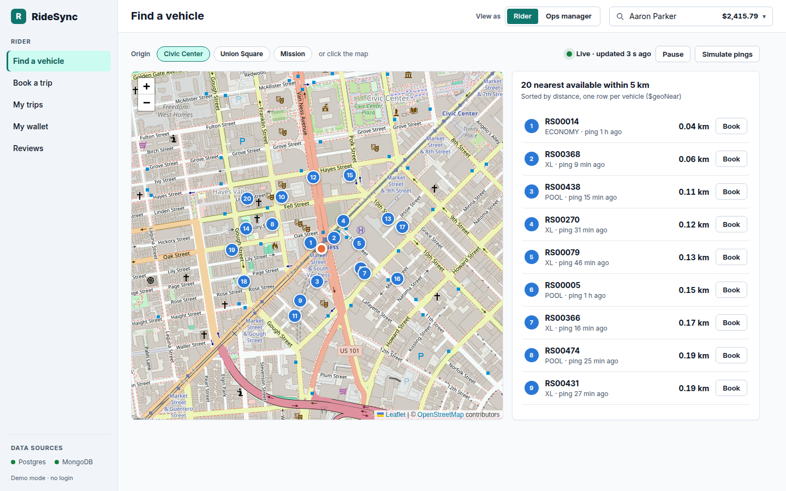
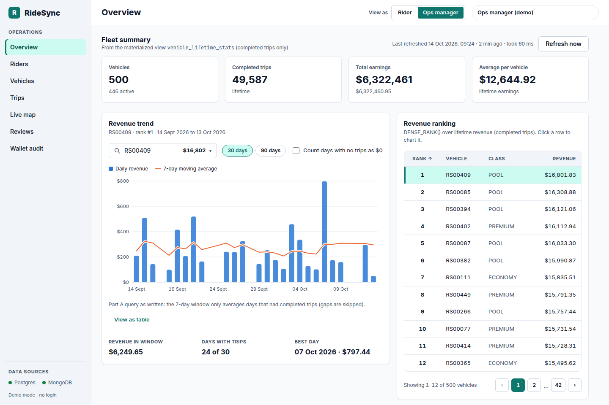
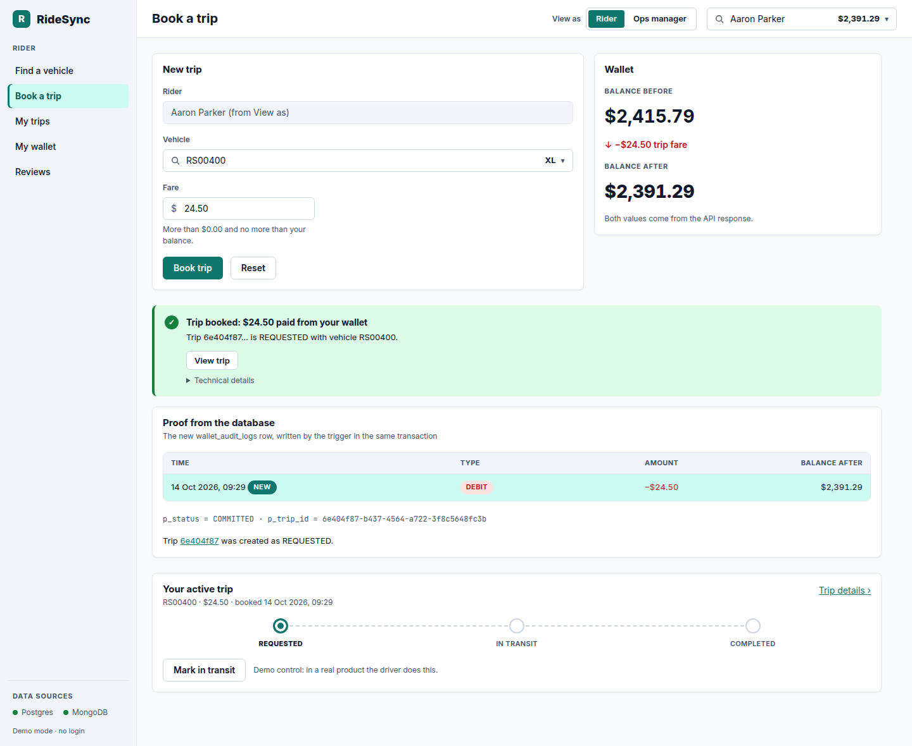
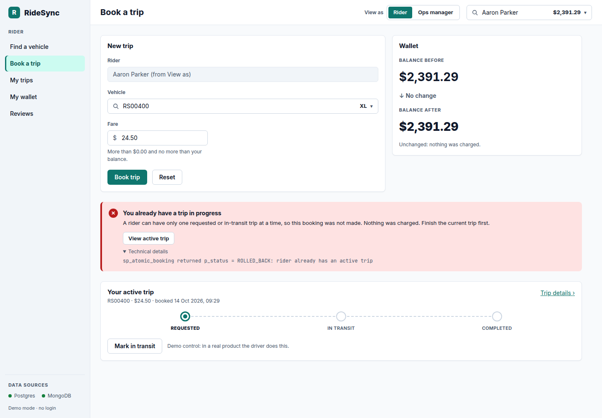
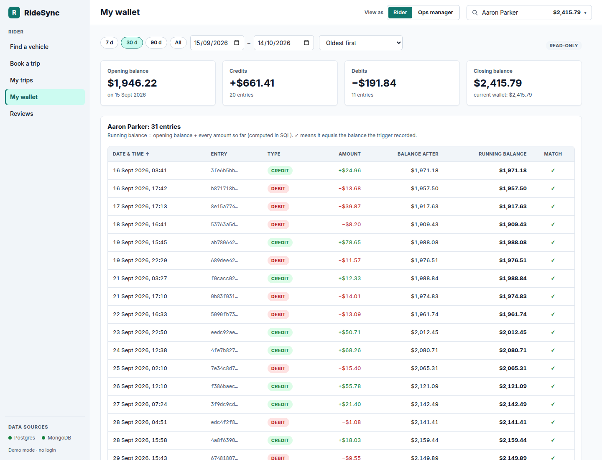
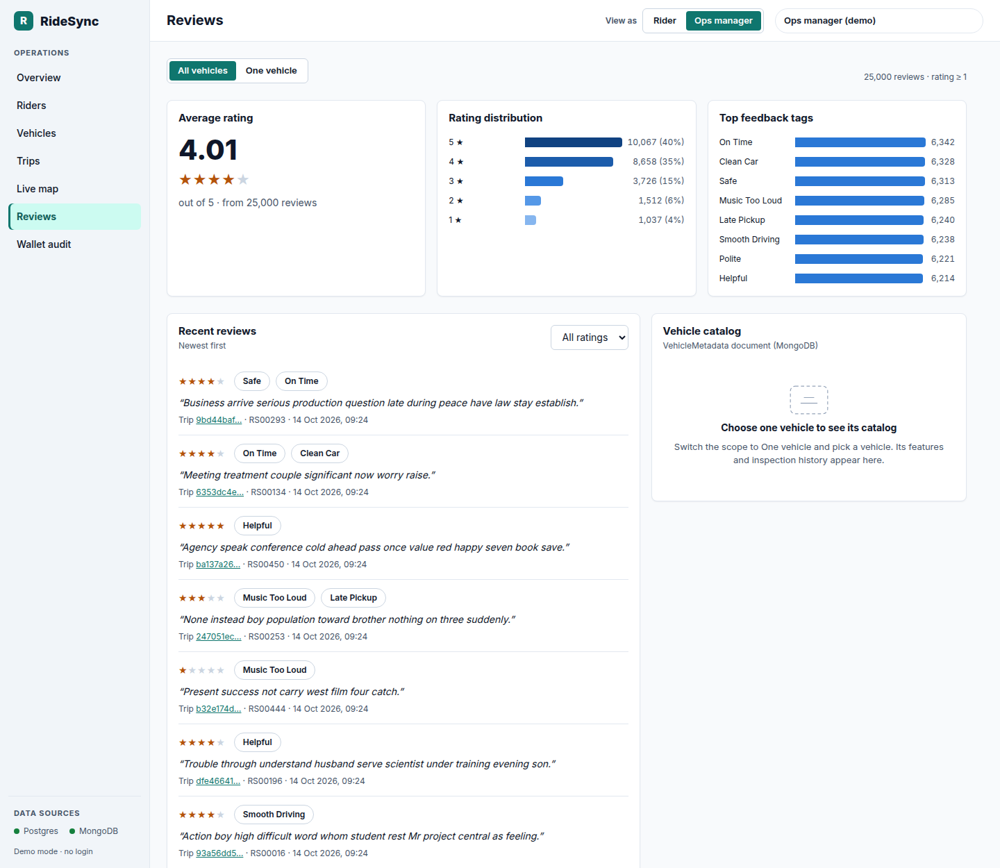
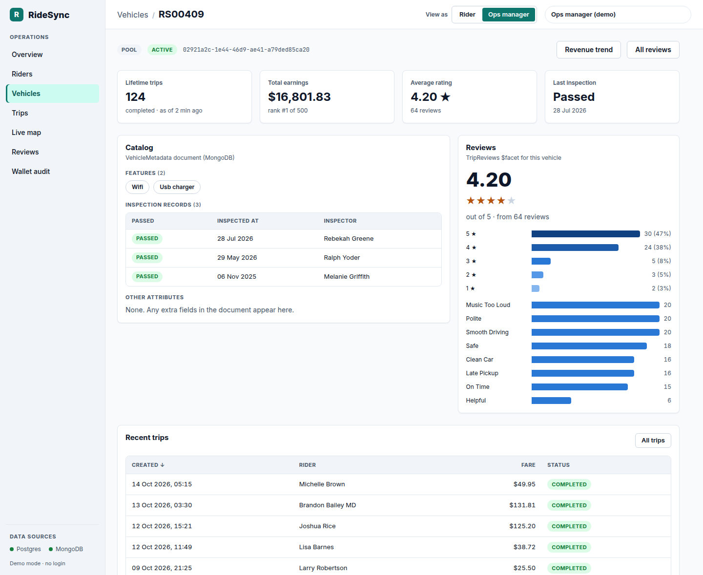
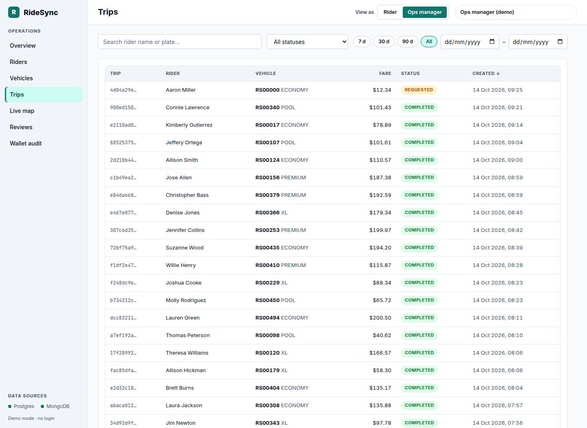

# RideSync: Assignment 2 (Team 20)

A web front end for the RideSync ride-hailing backend inherited from Assignment 1 (Project 2). The stack is PostgreSQL +
MongoDB, a FastAPI layer and a React app. It covers the four Part A workflows plus browsing, for two kinds of users: a
**Rider** and a **Fleet operations manager**.

| | |
|---|---|
| Course | CS6.302 Software System Development, Assignment 2 |
| Team | 20 |
| Repository | https://github.com/kcabhinavn/database_team20 |
| Final commit | `TODO: paste the hash of the final commit` |
| Demo video (≤ 5 min) | `TODO: link` |

**Documents:**
- [Handover note](docs/handover_note.md): what we inherited, what was broken, and what we changed.
- [API endpoints](docs/api_endpoints.md); live API docs at http://localhost:8000/docs.
- [Design](docs/design/README.md): users, 11 wireframes, style guide, UI kit.
- [Screenshots](#screenshots).

## 1. Run it (Docker, recommended)

You need Docker with Compose v2. The first build downloads about 2 GB of images.

```bash
docker compose up -d --build
```

```bash
docker compose --profile seed run --rm seed
```

| Open | What |
|---|---|
| http://localhost:8080 | the app |
| http://localhost:8000/docs | interactive API documentation |

- **Seeding** loads exactly the Part A volumes (50,000 trips, about 101,500 audit rows, 500,000 pings, 25,000 reviews).
  It takes about a minute once the images are built.
- **Map pings expire 2 hours after seeding** (the Part A TTL index). Before a demo, refresh them in about 20 s with the
  command below, or use the **Simulate pings** button on the map.
  ```bash
  docker compose --profile seed run --rm seed python mongo_seeder.py --reset --pings-only
  ```
- **Start from empty:** `docker compose down -v`, then run both commands above again.
- **Demo links:** add `?as=ops` or `?as=rider` to any URL to choose who you are acting as.
- **Ports:** web 8080, API 8000, Postgres 5433, Mongo 27017. To change them, set `WEB_PORT`, `API_PORT`, `PG_HOST_PORT`
  or `MONGO_HOST_PORT` before `docker compose up`.
- **Database volume from before Assignment 2?** Apply the two new scripts once:
  ```bash
  docker exec -i team20-postgres psql -U ridesync -d ridesync < sql/07_a2_frontend_support.sql
  ```
  ```bash
  docker exec -i team20-mongo mongosh ridesync --quiet < mongo/04_a2_indexes_and_validators.js
  ```

**Day-to-day commands**

| Task | Command |
|---|---|
| See what is running | `docker compose ps` |
| Stop (the data is kept) | `docker compose down` |
| Start again later (no rebuild) | `docker compose up -d` |
| Rebuild after changing code | `docker compose up -d --build` |
| Wipe everything and start from empty (then seed again) | `docker compose down -v` |

**A quick demo route**

1. **Rider:** on **Find a vehicle**, press **Book** on a vehicle, enter a fare and book. The page shows the balance before
   and after, and the new audit row marked NEW.
2. Press **Book trip** again. It is blocked: "You already have a trip in progress".
3. Press **Mark in transit**, then **Mark completed**, then book again. This time it succeeds.
4. Open **My wallet** and try the date filters. Every running balance shows ✓.
5. Switch to **Ops manager**. On **Overview**, press **Refresh now** and click a vehicle in the ranking to chart it.
6. Visit **Vehicles**, then one vehicle (its catalog and reviews), then **Reviews**, **Live map** and **Wallet audit**.

## 2. Run for development (hot reload)

These steps run the databases in Docker and the API and web app on your machine. You need Python 3.12 and Node 22.
On Ubuntu, `python3 -m venv` needs the `python3-venv` package; any other Python 3.12, such as conda, also works.

```bash
docker compose up -d postgres mongo
```

```bash
python3 -m venv .venv && .venv/bin/pip install -r data_generation/requirements.txt -r api/requirements-dev.txt
```

```bash
.venv/bin/python data_generation/postgres_seeder.py --reset && .venv/bin/python data_generation/mongo_seeder.py --reset
```

```bash
cd api && ../.venv/bin/uvicorn app.main:app --reload --port 8000
```

```bash
cd web && npm ci && npm run dev
```

The dev server runs at http://localhost:5173 and proxies `/api` to port 8000. The seeders and the API default to the
Compose ports (Postgres 5433); override them with `PGHOST`, `PGPORT` and `MONGO_URI`.

- **No Node installed?** On Linux, run the web dev server through Docker instead:
  ```bash
  cd web && docker run --rm -it --network host -u "$(id -u):$(id -g)" -e HOME=/tmp -v "$PWD":/app -w /app node:22-alpine sh -c "npm ci && npx vite --host 127.0.0.1"
  ```
- **The full Docker stack (section 1) is also running?** Stop its API and web containers first, so ports 8000 and 8080
  are free:
  ```bash
  docker compose stop api web
  ```

## 3. Tests

| Suite | Command | What it covers |
|---|---|---|
| API (50 integration tests, pytest) | `cd api && ../.venv/bin/python -m pytest` | Booking success and every rollback reason. The full blocked → advance → book-again journey. Fare rounding. Status transitions. Audit running balance and summary. Dense-rank ties. Trend values (Part A and zero-fill) checked by hand. `$geoNear` de-duplication and radius. Simulated pings. `$facet` counts. Paging limits. Validation and error shapes. |
| Web (59 unit and component tests, Vitest) | `cd web && npm test` (or `docker build --target test web`) | Booking page: success shows before/after balances and the trigger's audit row; a block explains itself and links to the active trip; the fare is validated before any request. Wallet audit page. Every booking message. Money and date formatting. Chart scales. Pagination. Loading, empty and error states. The generic catalog renderer. The API client's error handling. |
| Type check | `cd web && npm run typecheck` | Strict TypeScript over the whole app. |

The API tests need the Compose databases running. They build their own throw-away `ridesync_test` databases from the
project's `sql/` scripts and a small dataset whose expected values are worked out by hand (`api/tests/seed.py`), so they
never touch the demo data.

### Troubleshooting

- **"Port is already allocated":** another program or container is using 8080, 8000, 5433 or 27017. Stop it, or choose
  other ports:
  ```bash
  WEB_PORT=8081 API_PORT=8001 PG_HOST_PORT=5434 MONGO_HOST_PORT=27018 docker compose up -d --build
  ```
  If you move Postgres or Mongo, point the dev-mode seeders and tests at the new ports too: `PGPORT`/`TEST_PGPORT` and
  `MONGO_URI`/`TEST_MONGO_URI`.
- **The map is empty:** the pings expired (2 h TTL). Run the `--pings-only` command from section 1, or press
  **Simulate pings**.
- **Map tiles don't appear:** they come from OpenStreetMap and need internet. Everything else works offline.
- **Windows PowerShell:** the `docker compose` commands are the same. The `<` redirect used in section 1 doesn't work
  there; pipe the file instead:
  `Get-Content sql/07_a2_frontend_support.sql | docker exec -i team20-postgres psql -U ridesync -d ridesync`.
- **MongoDB will not start natively on Linux kernel 6.19 or newer:** this is MongoDB 8.0's SERVER-121912, and it is why
  Compose uses `mongo:7`.

## 4. What the app does

| Assignment screen | Route | User | Backed by (Part A + Assignment 2) |
|---|---|---|---|
| 1. Browse | `/trips`, `/riders`, `/vehicles` (+ detail pages) | Ops (riders see "My trips") | Paged and filtered SQL; the materialized view for vehicle stats |
| 2. Transaction (Workflow 1) | `/book` | Rider | `CALL sp_atomic_booking`. Shows the balance before and after, the new `wallet_audit_logs` row, a plain-language message for every rollback, and a stepper to move the trip forward (`fn_advance_trip_status`) |
| 3. Audit trail | `/wallet` | Rider (own wallet) / Ops (any rider) | `wallet_audit_logs` (read-only), date filter, SQL running balance with a ✓ against each recorded balance |
| 4. Analytics (Workflow 2 + MV) | `/analytics` | Ops | 7-day moving-average chart (Part A query, optional calendar zero-fill), `DENSE_RANK()` ranking, materialized-view totals with "last refreshed" and Refresh |
| 5. Map (Workflow 3) | `/map` | Rider ("Book") / Ops ("Details") | `$geoNear` 5 km, one row per vehicle, polled every 5 s, NEW markers, click to move the origin, Simulate pings |
| 6. Reviews (Workflow 4) | `/reviews`, vehicle detail | Both | `$facet`: rating distribution, top tags, average (all or one vehicle), plus the `VehicleMetadata` catalog document rendered generically |

Every data region has its own loading, empty and error state. A MongoDB outage only affects the MongoDB-backed cards. The
layout works from 375 px phones up.

## 5. Architecture and code layout

```text
browser ──► nginx :8080 ──/api──► FastAPI :8000 ──► PostgreSQL 16  (procedures, triggers, views, MV)
 (React SPA)                                     └─► MongoDB 7      ($geoNear, $facet, catalog)
```

```text
api/                       FastAPI app
  app/config.py            settings from the environment
  app/db/                  Postgres pool (autocommit), Mongo client, safe WHERE builder
  app/schemas/             Pydantic request/response models (also the OpenAPI docs)
  app/services/            all SQL and pipeline logic, one module per domain, no HTTP code
  app/routers/             thin HTTP layer: validate → call a service → respond
  app/errors.py            one error shape; 503 per data source
  tests/                   50 integration tests against a throw-away database
web/                       React + TypeScript (Vite)
  src/api/                 typed fetch client + TanStack Query hooks per domain
  src/components/          the reusable kit from the style guide (Button, Field, Combobox, DataTable, ...)
  src/features/<screen>/   one folder per screen, each with its own pieces
  src/layout/              shell, sidebar, top bar, "View as" switch
  src/lib/                 formatting, messages, dates (pure and unit-tested)
  src/styles/tokens.css    design tokens generated from docs/design
sql/  mongo/               Part A scripts + 07 / 04 (Assignment 2 additions)
data_generation/           Part A seeders (+ Assignment 2 fixes) and the seed container
docs/                      handover note, API, design, screenshots
```

## 6. Technology choices

- **FastAPI, psycopg 3 and pymongo.** Python matches the Part A seeders. Pydantic validates every input and generates the
  OpenAPI docs for free. A small autocommit pool is exactly what `sp_atomic_booking` needs, because it issues
  `COMMIT`/`ROLLBACK` itself.
- **React 19, TypeScript and Vite.** Components suit the reusable UI kit from the design. TypeScript catches mismatches
  with the API shapes at build time. Vite gives fast reloads and an `/api` proxy.
- **TanStack Query.** Caching, refetch after a booking (invalidation), and the 5-second map polling without hand-written
  state code.
- **React Router.** Filters and paging live in the URL, so back, refresh and sharing all work.
- **Leaflet with OpenStreetMap tiles.** Free with no API key, and lazy-loaded, so it only downloads on the map screen.
- **Small custom SVG charts.** Two chart types did not justify a charting library. They follow our chart rules: one
  axis, legend, hover tooltip, a table view, and the validated palette.
- **CSS Modules and generated design tokens.** A consistent look with no CSS framework. `tokens.css` is generated from
  `docs/design`, so the code cannot drift from the style guide.
- **Docker Compose.** One command for a new person. Mongo is pinned to 7 because MongoDB 8.0 refuses to start on Linux
  kernels ≥ 6.19.
- Dependency versions are pinned to stable major versions (for example Vite 6 and TypeScript 5), and lockfiles are
  committed.

## 7. Assumptions

- **No real login**, as the brief allows. **View as** switches between Rider and Ops manager; in Rider mode you pick which
  seeded rider you are, and the first rider without an active trip is chosen by default.
- **Fares are typed in by hand** (there is no pricing model). Fares must be greater than $0.00. Money is USD, because the
  data is in San Francisco.
- **Trip status controls are demo controls.** "Mark in transit" and "Mark completed" stand in for a driver app, so the
  partial unique index can be shown both blocking and allowing a booking. There is no cancel status, because Part A
  does not define one.
- **Workflow 2** shows the Part A query exactly by default (its window averages only days that had trips). A checkbox
  switches to a calendar 7-day average; see handover note #8. The trend window ends on the vehicle's last day with
  revenue.
- **The materialized view is a snapshot.** Fleet totals and vehicle stats change only when you press Refresh, and the
  "last refreshed" time is shown. The ranking and trend read trips live.
- **"Nearest vehicle"** follows Part A: the nearest *available* ping, shown once per vehicle.
- **Dates:** the audit and trip date filters use inclusive UTC days, and times are shown in the viewer's time zone.
- **Reviews are read-only**, because writing reviews is not one of the workflows.
- **Internet is needed** for map tiles and web fonts only; everything else runs offline. The app has a light theme only.

## 8. Changes to the inherited Part A code

The handover note has the full list with reasons. In short:

| File | Change |
|---|---|
| `docker-compose.yml` (new) | Whole stack: databases (auto-initialised), API, web and a seed job |
| `sql/04_stored_procedures.sql` | Fare rounded once; fare ≤ 0 rejected; "insufficient balance" only for the wallet CHECK |
| `sql/07_a2_frontend_support.sql` (new) | Opening-balance audit trigger, MV refresh log, `fn_advance_trip_status`, ranking view, trend function |
| `mongo/04_a2_indexes_and_validators.js` (new) | Per-vehicle review and catalog indexes; validators aligned with the schema map |
| `data_generation/postgres_seeder.py` | About 40% of riders mid-trip (was 99.9%); audit history spread over 90 days; MV refreshed; default port 5433 |
| `data_generation/mongo_seeder.py` | Per-vehicle movement tracks on land; `--pings-only`; default port 5433 |
| `data_generation/requirements.txt` | `pymongo` 4.8.0 → 4.18.3 (same version as the API, so one virtualenv works) |
| `.gitignore` | `.venv/`, `node_modules/`, build output, test caches |

`sql/06_window_analytics.sql` and the `performance/` evidence are unchanged.

## Screenshots

| | |
|---|---|
|  Find a vehicle (Workflow 3) |  Overview (Workflow 2 + MV) |
|  Booking committed, with the trigger's audit row |  Booking blocked by the partial unique index |
|  Wallet audit with running balance |  Reviews `$facet` |
|  Vehicle detail with the catalog document |  Browsing 50,000 trips |

## Contribution

| Member | Roll number | Contribution |
|---|---|---|
| TODO | TODO | TODO |
| TODO | TODO | TODO |
| TODO | TODO | TODO |
| TODO | TODO | TODO |

## Submitting

After the final commit, fill in the commit hash and the demo-video link above. Then build the ZIP from git (it must be
under 20 MB). This automatically leaves out `node_modules/`, `.venv/`, `__pycache__/`, `dist/` and the databases:

```bash
git archive --format=zip -o 20_a1b.zip HEAD
```

---

*The original Assignment 1 README follows, unchanged. Its PowerShell setup still works on Windows with native installs.*

# RideSync — Assignment 1 (Project 2)

PostgreSQL + MongoDB persistence for a global ride-hailing network. No application frontend; all work is schema, indexes, procedures, aggregations, seeders, and query plans.

- **Course:** CS6.302 Software System Development
- **Project:** 2 — RideSync
- **Team number:** 1
- **GitHub:** https://github.com/kushlalve07/2026201061_a1
- **Final commit hash:** `b5843a6`

## Repository layout

```
README.md
docs/relational_erd.png
docs/mongo_schema_map.json
sql/01_schema_ddl.sql
sql/02_indexes.sql
sql/03_triggers_and_audit.sql
sql/04_stored_procedures.sql
sql/05_materialized_views.sql
sql/06_window_analytics.sql
mongo/01_collections_and_indexes.js
mongo/02_workflow3_geonear.js
mongo/03_workflow4_facet.js
data_generation/postgres_seeder.py
data_generation/mongo_seeder.py
data_generation/requirements.txt
performance/postgres_explain_analyzes.txt
performance/mongo_execution_stats.json
```

## Assumptions

- Primary keys are UUID via `gen_random_uuid()` (PostgreSQL 13+). No `uuid-ossp`.
- Trip status `IN_TRANSIT` uses an underscore (SQL token). The brief writes “IN TRANSIT”.
- Workflow 1 escrow is a debit of `riders.wallet_balance` by `fare_amount`. There is no extra escrow column. The audit trigger records the DEBIT.
- `wallet_audit_logs` is append-only (trigger blocks UPDATE/DELETE). Rows are produced by `AFTER UPDATE OF wallet_balance` on `riders`, not by bulk INSERT into the log table.
- Materialized view `vehicle_lifetime_stats` counts **COMPLETED** trips only for trip count and earnings.
- Partial unique index `idx_active_rider_trip` uses `REQUESTED` / `IN_TRANSIT` so a rider has at most one active trip.
- Mongo GeoJSON is `[longitude, latitude]`. Telemetry pings are clustered around San Francisco `[-122.4194, 37.7749]` so Workflow 3’s 5 km `$geoNear` hits.
- TTL on `TelemetryPings.created_at` is 7200 seconds (2 hours). Seed `created_at` is within the last 90 minutes so pings survive long enough to capture `explain`. Re-seed before a viva if TTL has expired.
- Workflow 4 `$match` is `rating >= 1` so the pipeline uses index `rating_1` (same pipeline as `performance/mongo_execution_stats.json`).
- No Docker. Local PostgreSQL 13+ and MongoDB 7 + `mongosh`.
- Python dependencies: `data_generation/requirements.txt`.

## Setup

### PostgreSQL

Install PostgreSQL and add `psql` to PATH. As superuser `postgres`:

```sql
CREATE USER ridesync WITH PASSWORD 'ridesync';
CREATE DATABASE ridesync OWNER ridesync;
```

Connect as `ridesync` to database `ridesync` (so that user owns the objects), then:

```sql
\i sql/01_schema_ddl.sql
\i sql/02_indexes.sql
\i sql/03_triggers_and_audit.sql
\i sql/04_stored_procedures.sql
\i sql/05_materialized_views.sql
```

From PowerShell (project root), if `psql` is on PATH:

```powershell
$env:PGPASSWORD = "ridesync"
psql -h localhost -p 5432 -U ridesync -d ridesync -f sql/01_schema_ddl.sql
psql -h localhost -p 5432 -U ridesync -d ridesync -f sql/02_indexes.sql
psql -h localhost -p 5432 -U ridesync -d ridesync -f sql/03_triggers_and_audit.sql
psql -h localhost -p 5432 -U ridesync -d ridesync -f sql/04_stored_procedures.sql
psql -h localhost -p 5432 -U ridesync -d ridesync -f sql/05_materialized_views.sql
```

ERD: [docs/relational_erd.png](docs/relational_erd.png)

### MongoDB

```powershell
mongosh ridesync mongo/01_collections_and_indexes.js
```

Creates `VehicleMetadata`, `TripReviews`, `TelemetryPings`; `2dsphere` on `location`; TTL 7200s on `created_at`; `rating` index on reviews.

Schema map: [docs/mongo_schema_map.json](docs/mongo_schema_map.json)

### Seed (Step 4)

```powershell
python -m venv .venv
.\.venv\Scripts\Activate.ps1
pip install -r data_generation/requirements.txt

python data_generation/postgres_seeder.py --reset
python data_generation/mongo_seeder.py --reset
```

`--reset` truncates / deletes existing seed rows first. Expected:

| Store | Minimum |
| --- | --- |
| `trips` | ≥ 50,000 |
| `wallet_audit_logs` | ≥ 100,000 (via wallet UPDATE trigger) |
| `TelemetryPings` | ≥ 500,000 |

Then:

```sql
SELECT refresh_vehicle_lifetime_stats();
```

`sql/06_window_analytics.sql` is a **query**, not DDL. Run it only after seed.

## Workflows

### Workflow 1 — atomic booking (`sql/04_stored_procedures.sql`)

`sp_atomic_booking`: `REPEATABLE READ`, debit wallet (escrow), insert `REQUESTED` trip, commit. CHECK / unique / missing rider-or-vehicle failures roll back (`p_status` explains why).

```sql
CALL sp_atomic_booking('<rider_uuid>', '<vehicle_uuid>', 10.00, NULL, NULL);
```

Pick a rider with no `REQUESTED`/`IN_TRANSIT` trip. Oversize fare should set `ROLLED_BACK: insufficient wallet balance` and leave no trip.

### Workflow 2 — window analytics (`sql/06_window_analytics.sql`)

CTEs: daily completed fare per vehicle, 7-day moving average (`RANGE BETWEEN INTERVAL '6 days'`), `DENSE_RANK()` on lifetime revenue.

```sql
\i sql/06_window_analytics.sql
```

### Workflow 3 — nearest vehicle (`mongo/02_workflow3_geonear.js`)

`$geoNear` within 5 km of `[-122.4194, 37.7749]`, `is_available: true`, then `$project` and `$limit: 1`.

```powershell
mongosh ridesync mongo/02_workflow3_geonear.js
```

### Workflow 4 — review `$facet` (`mongo/03_workflow4_facet.js`)

`$match rating >= 1`, then `$facet`: rating histogram, `$unwind` tags, overall average.

```powershell
mongosh ridesync mongo/03_workflow4_facet.js
```

## Performance proofs (Workflows 2, 3, 4)

Raw logs: [performance/postgres_explain_analyzes.txt](performance/postgres_explain_analyzes.txt), [performance/mongo_execution_stats.json](performance/mongo_execution_stats.json).

### Workflow 2 — `EXPLAIN (ANALYZE, BUFFERS)`

Completed trips are read with **Index Only Scan** on partial covering index `idx_trips_completed_vehicle_date` (`WHERE status = 'COMPLETED'`). Not a sequential scan of `trips`. `Seq Scan on vehicles` is the 500-row fleet table.

```
QUERY PLAN
-----------------------------------------------------------------------------------------------------------------------------------------------------------------------------------
 Sort  (cost=16401.15..16523.14 rows=48797 width=132) (actual time=100.475..101.366 rows=29980 loops=1)
   Sort Key: r.revenue_rank, daily_revenue.vehicle_id, daily_revenue.revenue_date
   Sort Method: quicksort  Memory: 3110kB
   Buffers: shared hit=401
   CTE daily_revenue
     ->  GroupAggregate  (cost=8.56..5797.02 rows=48797 width=52) (actual time=0.200..31.547 rows=29980 loops=1)
           Group Key: trips.vehicle_id, (date(trips.created_at))
           Buffers: shared hit=397
           ->  Incremental Sort  (cost=8.56..4697.51 rows=49007 width=26) (actual time=0.191..17.291 rows=49001 loops=1)
                 Sort Key: trips.vehicle_id, (date(trips.created_at))
                 Presorted Key: trips.vehicle_id
                 Full-sort Groups: 500  Sort Method: quicksort  Average Memory: 28kB  Peak Memory: 28kB
                 Pre-sorted Groups: 500  Sort Method: quicksort  Average Memory: 30kB  Peak Memory: 30kB
                 Buffers: shared hit=397
                 ->  Index Only Scan using idx_trips_completed_vehicle_date on trips  (cost=0.41..2454.04 rows=49007 width=26) (actual time=0.112..8.386 rows=49001 loops=1)
                       Heap Fetches: 0
                       Buffers: shared hit=397
   ->  Hash Join  (cost=1253.36..3465.19 rows=48797 width=132) (actual time=41.432..85.162 rows=29980 loops=1)
         Hash Cond: (r.vehicle_id = v.id)
         Buffers: shared hit=401
         ->  Hash Join  (cost=1238.11..3320.76 rows=48797 width=140) (actual time=41.262..80.342 rows=29980 loops=1)
               Hash Cond: (daily_revenue.vehicle_id = r.vehicle_id)
               Buffers: shared hit=397
               ->  WindowAgg  (cost=0.04..1951.88 rows=48797 width=84) (actual time=0.222..33.580 rows=29980 loops=1)
                     Buffers: shared hit=5
                     ->  CTE Scan on daily_revenue  (cost=0.00..975.94 rows=48797 width=52) (actual time=0.202..1.751 rows=29980 loops=1)
                           Buffers: shared hit=5
               ->  Hash  (cost=1235.57..1235.57 rows=200 width=56) (actual time=41.029..41.032 rows=500 loops=1)
                     Buckets: 1024  Batches: 1  Memory Usage: 44kB
                     Buffers: shared hit=392
                     ->  Subquery Scan on r  (cost=1230.09..1235.57 rows=200 width=56) (actual time=40.753..40.972 rows=500 loops=1)
                           Buffers: shared hit=392
                           ->  WindowAgg  (cost=1230.09..1233.57 rows=200 width=56) (actual time=40.753..40.936 rows=500 loops=1)
                                 Buffers: shared hit=392
                                 ->  Sort  (cost=1230.07..1230.57 rows=200 width=48) (actual time=40.746..40.769 rows=500 loops=1)
                                       Sort Key: (sum(daily_revenue_1.daily_total)) DESC
                                       Sort Method: quicksort  Memory: 48kB
                                       Buffers: shared hit=392
                                       ->  GroupAggregate  (cost=0.00..1222.43 rows=200 width=48) (actual time=0.137..40.610 rows=500 loops=1)
                                             Group Key: daily_revenue_1.vehicle_id
                                             Buffers: shared hit=392
                                             ->  CTE Scan on daily_revenue daily_revenue_1  (cost=0.00..975.94 rows=48797 width=48) (actual time=0.000..36.733 rows=29980 loops=1)
                                                   Buffers: shared hit=392
         ->  Hash  (cost=9.00..9.00 rows=500 width=24) (actual time=0.160..0.160 rows=500 loops=1)
               Buckets: 1024  Batches: 1  Memory Usage: 36kB
               Buffers: shared hit=4
               ->  Seq Scan on vehicles v  (cost=0.00..9.00 rows=500 width=24) (actual time=0.017..0.076 rows=500 loops=1)
                     Buffers: shared hit=4
 Planning:
   Buffers: shared hit=61
 Planning Time: 4.899 ms
 Execution Time: 102.829 ms
```

~49,001 completed trips from the index; ~103 ms.

### Workflow 3 — `explain("executionStats")`

Full JSON: `performance/mongo_execution_stats.json` → `Workflow_3_GeoNear`.

- Namespace: `ridesync.TelemetryPings`
- Winning plan: **`GEO_NEAR_2DSPHERE`** on `location_2dsphere`, child **`IXSCAN`** (not `COLLSCAN`)
- `query`: `is_available: true`, `maxDistance: 5000`, near `[-122.4194, 37.7749]`
- `nReturned`: 6251 geo candidates; pipeline ends with `$limit: 1`
- `totalDocsExamined`: 18778
- `executionTimeMillis`: 90

```json
"winningPlan": {
  "stage": "FETCH",
  "filter": { "is_available": { "$eq": true } },
  "inputStage": {
    "stage": "GEO_NEAR_2DSPHERE",
    "keyPattern": { "location": "2dsphere" },
    "indexName": "location_2dsphere",
    "inputStages": [
      {
        "stage": "FETCH",
        "inputStage": {
          "stage": "IXSCAN",
          "keyPattern": { "location": "2dsphere" },
          "indexName": "location_2dsphere"
        }
      }
    ]
  }
}
```

```json
"executionStats": {
  "executionSuccess": true,
  "nReturned": 6251,
  "executionTimeMillis": 90,
  "totalKeysExamined": 10937,
  "totalDocsExamined": 18778
}
```

### Workflow 4 — `explain("executionStats")`

Full JSON: same file → `Workflow_4_Facet`. Matches `mongo/03_workflow4_facet.js`.

- Namespace: `ridesync.TripReviews`
- `$match`: `rating >= 1`
- Winning plan: **`IXSCAN`** on `rating_1` (not `COLLSCAN`)
- `$facet`: `rating_distribution`, `driver_feedback_tags` (`$unwind`), `overall_average`
- `nReturned`: 25000
- `executionTimeMillis`: 136

```json
"parsedQuery": { "rating": { "$gte": 1 } },
"winningPlan": {
  "stage": "PROJECTION_SIMPLE",
  "inputStage": {
    "stage": "FETCH",
    "inputStage": {
      "stage": "IXSCAN",
      "keyPattern": { "rating": 1 },
      "indexName": "rating_1",
      "indexBounds": { "rating": ["[1, inf.0]"] }
    }
  }
}
```

```json
"executionStats": {
  "executionSuccess": true,
  "nReturned": 25000,
  "executionTimeMillis": 136,
  "totalKeysExamined": 25000,
  "totalDocsExamined": 25000
}
```
