# Design: RideSync front end (Step 2)

| File | What it is |
|---|---|
| [users.md](users.md) | The two users (Rider, Fleet ops manager), what each wants to do, screens per user, demo journeys |
| [wireframes/](wireframes/) | 11 low-fidelity wireframes (SVG). Each has numbered annotations explaining behaviour and the API call behind it |
| [style_guide.md](style_guide.md) | Colours, type, spacing, the component set, number/date formatting, error messages, accessibility |
| [ui_kit.svg](ui_kit.svg) | The colours and components drawn in the real palette |
| [tokens.css](tokens.css) | The design tokens as CSS custom properties; the web app imports this file |
| [src/build_design.py](src/build_design.py) | Generates all of the above (`python3 docs/design/src/build_design.py`) |

The wireframes are generated from one script so every screen shares the same shell, grid and component shapes. To change
a screen, edit its function and re-run the script.

## Key design decisions

1. **One app, two modes.** A **View as** switch in the top bar (Rider / Ops manager) replaces login, as the brief allows. In Rider
   mode, a picker selects which of the 1,000 seeded riders you are, and their balance is always visible.
2. **Shared screens, scoped by role.** Trips, Wallet, Map and Reviews are each one screen. A rider sees only their own
   trips and wallet; the ops manager can pick anyone. That means fewer screens to build and a more consistent app.
3. **Workflows are proven on screen.** The booking result shows the balance before and after plus the new
   `wallet_audit_logs` row (so the trigger visibly fired). The analytics page shows when the materialized view was last
   refreshed. The audit table puts the computed running balance next to the recorded one.
4. **Failures are explained, not reported.** Every rollback reason has a plain-language title, says whether money moved,
   and offers the next step. The partial-unique-index journey (blocked → advance trip → book again) works from the
   error message itself.
5. **Each card owns its data.** Postgres and MongoDB failures stay local to the cards that use them, and every region has
   a loading, empty and error state (W09).
6. **Nothing loads the whole table.** All lists are paged and filtered on the server, and the URL keeps the filters.

## Wireframes

| # | Screen | User | Assignment screen |
|---|---|---|---|
| [W00](wireframes/00_sitemap.svg) | Users, screens and flows | both | overview |
| [W01](wireframes/01_trips_browse.svg) | Trips list (same pattern for Riders, Vehicles) | Ops / Rider | 1. Browse |
| [W02](wireframes/02_vehicle_detail.svg) | Vehicle detail with catalog document | Ops | 1. Browse (detail) + 6. catalog |
| [W03](wireframes/03_book_trip_success.svg) | Book a trip: success | Rider | 2. Transaction |
| [W04](wireframes/04_book_trip_failure.svg) | Book a trip: failure states | Rider | 2. Transaction |
| [W05](wireframes/05_wallet_audit.svg) | Wallet audit / My wallet | Ops / Rider | 3. Audit trail |
| [W06](wireframes/06_analytics_overview.svg) | Overview: trend, ranking, MV summary | Ops | 4. Analytics |
| [W07](wireframes/07_find_vehicle_map.svg) | Find a vehicle / Live map | Rider / Ops | 5. Map |
| [W08](wireframes/08_reviews_catalog.svg) | Reviews + vehicle catalog | Ops / Rider | 6. Reviews |
| [W09](wireframes/09_states.svg) | Loading, empty, error, partial failure | all | general expectations |
| [W10](wireframes/10_mobile.svg) | Phone layouts | Rider / Ops | general expectations |

### W00 Users, screens and flows
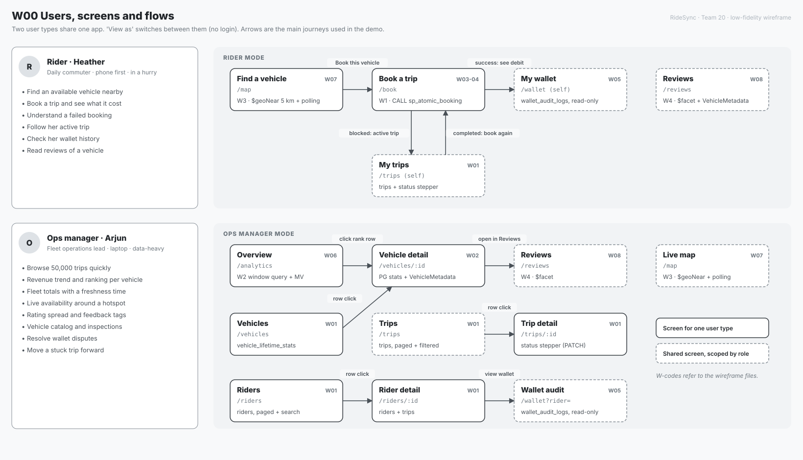

### W01 Browse: Trips
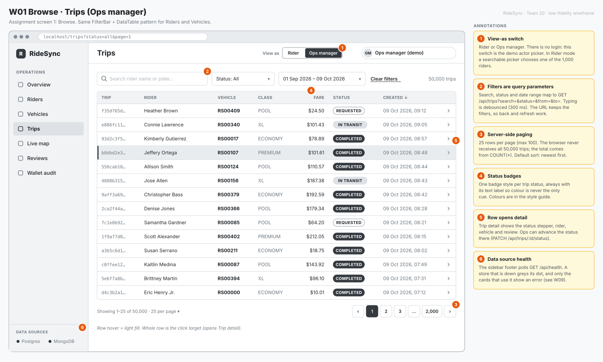

### W02 Vehicle detail
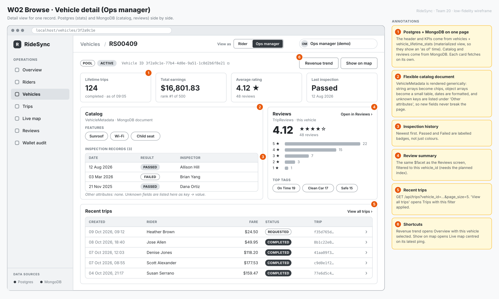

### W03 Book a trip: success
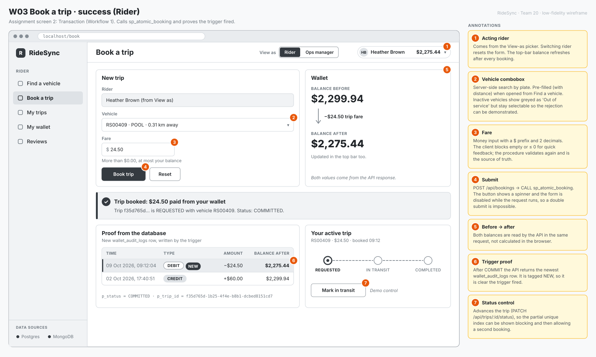

### W04 Book a trip: failures
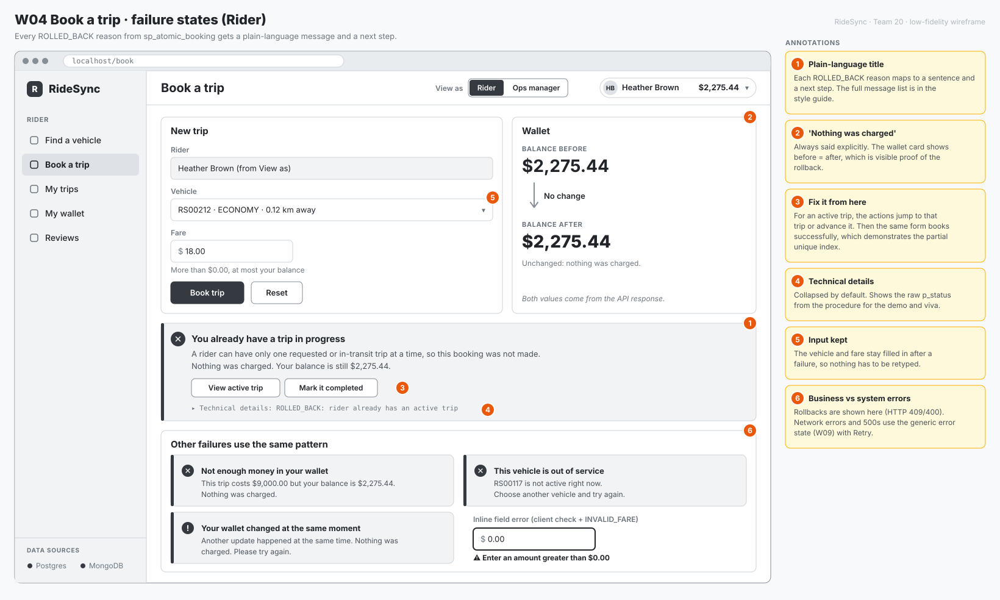

### W05 Wallet audit
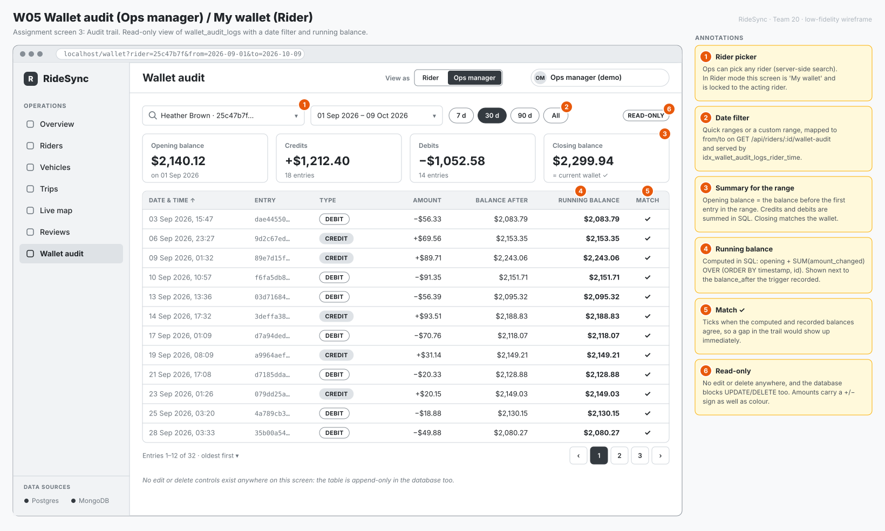

### W06 Overview (analytics)
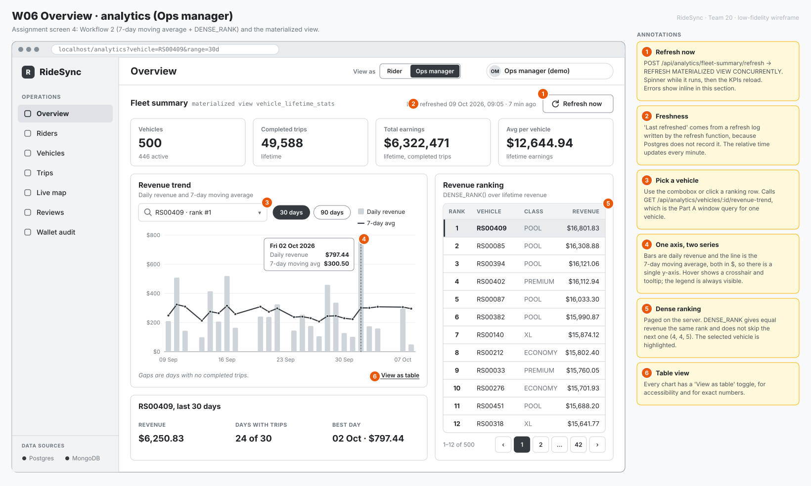

### W07 Find a vehicle / Live map
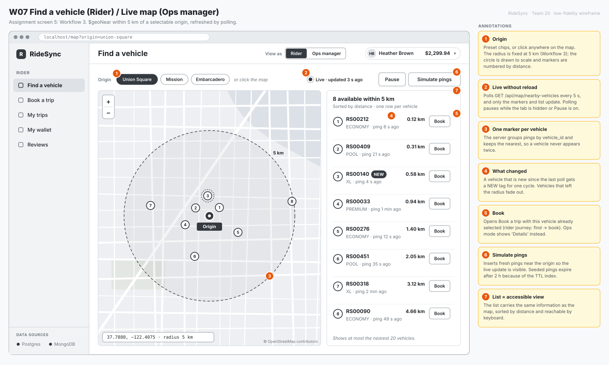

### W08 Reviews + catalog
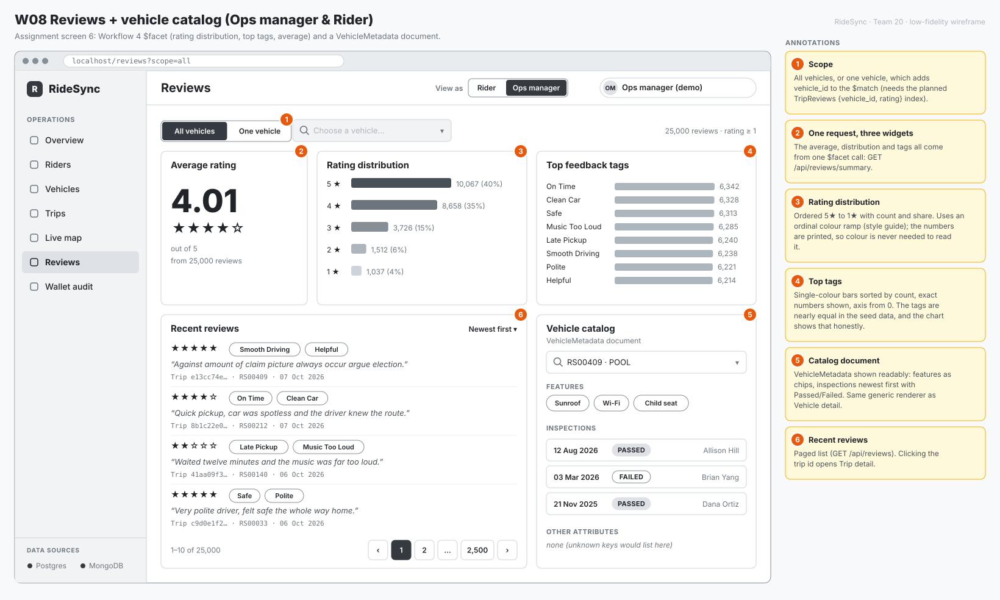

### W09 States
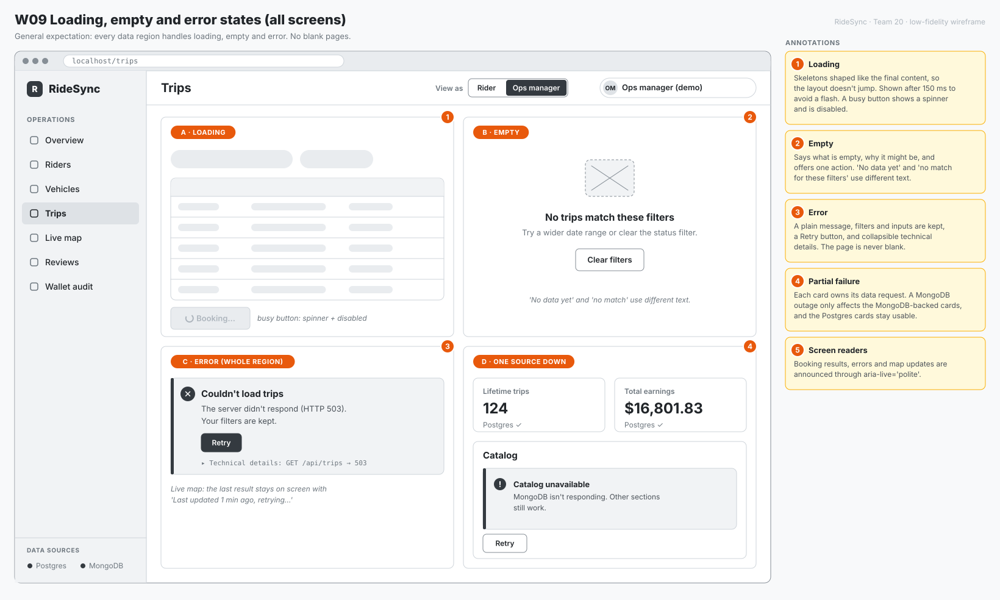

### W10 Phone
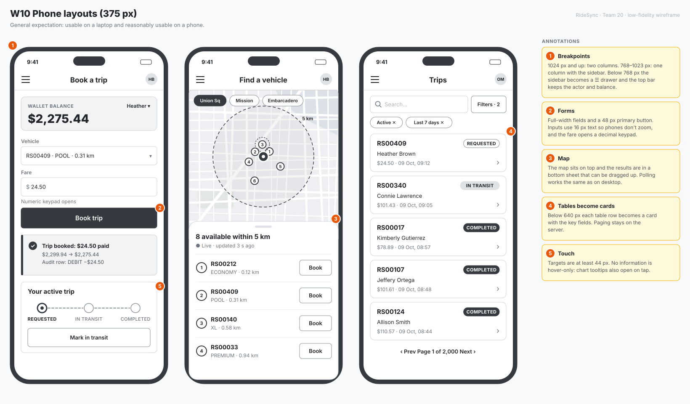

### UI kit
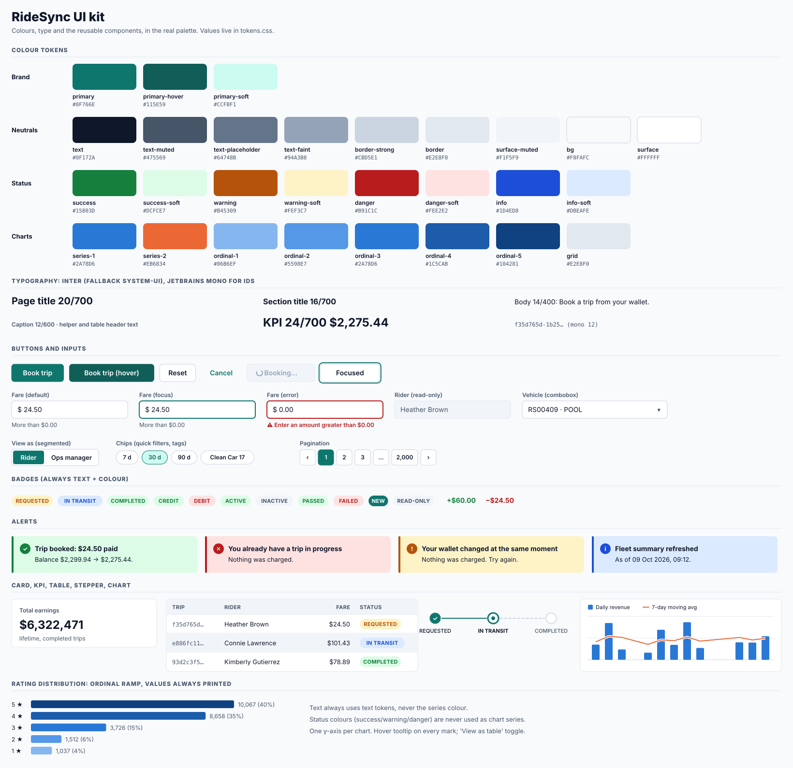

## From design to build (Step 3)

The app follows these wireframes; [screenshots](../../README.md#screenshots) show the result. A few things changed after
seeing real data:

- **Vehicle detail:** "Show on map" became **All reviews**. The map is searched from an origin, and there is no
  per-vehicle location endpoint.
- **Find a vehicle:** the presets are **Civic Center** (the Part A Workflow 3 origin), Union Square and Mission.
  Embarcadero sits on the shoreline.
- **Overview:** a **"Count days with no trips as $0"** checkbox was added (handover note #8). The Part A behaviour stays
  the default.
- **Layout:** the Overview and Map layouts put their two columns side by side only from 1280 px. Below that they stack,
  so the ranking and the vehicle list never get squeezed.
- **Demo links:** `?as=ops` / `?as=rider` select the user type.

## Assumptions made in the design

- The currency is USD, because the seed data is centred on San Francisco.
- The map origins are San Francisco landmarks, matching the seeded pings. The wireframe shows Embarcadero; the build uses Civic Center (the Part A origin), Union Square and Mission.
- There is a light theme only, and no real authentication.
- The "Mark in transit / completed" controls are demo controls so the partial unique index can be shown. A real product
  would have drivers move trips forward.
- Seeded audit history is spread over 90 days by the seeder (handover note #7), so the audit date filter has real
  dates to work with.
